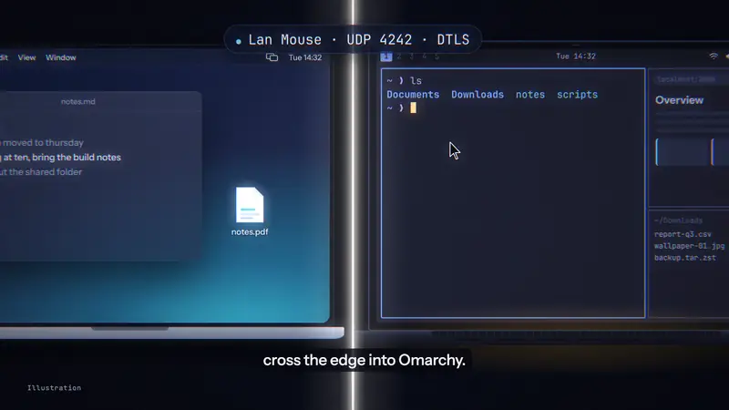
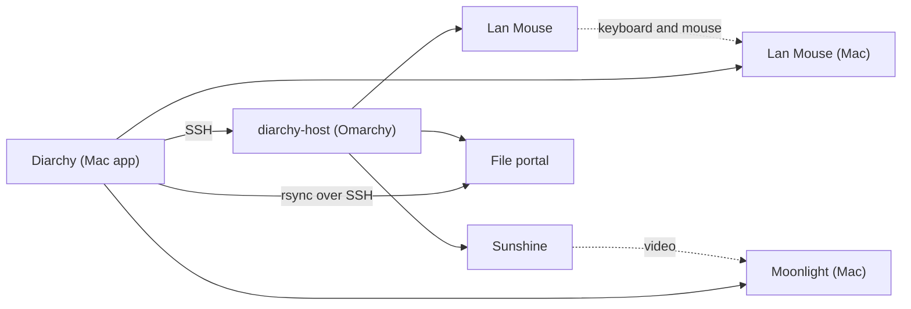

<h1 align="center"> Diarchy</h1>

<b>Run your Omarchy box from your Mac.</b>

Diarchy is a menu-bar app for Apple Silicon Macs. It controls an Omarchy machine (Arch Linux with Hyprland) over SSH.
You pick one mode from the menu bar: share your Mac keyboard and mouse with the host, or stream the host screen to
your Mac. Clipboard and file transfer work between both machines.

Status: public beta (0.1.0-beta.1)

  

<a href="https://agentic-engineering-agency.github.io/diarchy/"><b>Watch the 90-second film</b></a>

The film has English narration and captions on screen. The narration is an AI voice. It shows what Diarchy does and what
we measured on one pair of test machines.

## What it does

- **Off, KVM or Streaming.** One switch in the menu bar.
  - **KVM** uses [Lan Mouse](https://github.com/feschber/lan-mouse). Your Mac keyboard and mouse move across to the host.
  - **Streaming** uses [Sunshine](https://github.com/LizardByte/Sunshine) on the host and
    [Moonlight](https://github.com/moonlight-stream/moonlight-qt) on the Mac.
- **Clipboard.** Text copied on one machine can be pasted on the other.
- **File portal.** Drop files on the Mac app to send them to the host over SSH and rsync.
- **LAN or Tailscale.** Diarchy uses the local network when it can and your Tailscale network otherwise.
- **Lid-closed server mode.** A laptop host can keep streaming with the lid closed, with a virtual display.

## How it works

The app runs the `diarchy-host` command on the host over SSH. The host command starts and stops Lan Mouse and
Sunshine. The Mac keeps its settings in `~/.config/diarchy/diarchy.conf`. The host has no `diarchy.conf`. The app
never runs commands as root. When a step needs root, it shows the command for you to run.

## Requirements

- An Apple Silicon Mac with macOS 14 or later.
- Apple Command Line Tools on the Mac. Run `xcode-select --install`.
- An Omarchy host (Arch Linux with Hyprland), x86_64.
- SSH access to the host with a key, not a password.
- The Mac and the host on the same local network, or both on the same Tailscale network.

## Install

The app is ad-hoc signed and not notarized. There is no paid Apple Developer account behind it. macOS will warn you
the first time you open it.

1. Download the latest zip and `SHA256SUMS` from the [Releases](https://github.com/Agentic-Engineering-Agency/diarchy/releases) page.
2. Check the file: `shasum -a 256 -c SHA256SUMS`.
3. Open the zip in Finder. Drag `Diarchy.app` to the Applications folder in Finder.
4. Open `Diarchy.app`. macOS refuses the first time. Open System Settings > Privacy & Security, find the message
   about Diarchy and click "Open Anyway".

Full steps, build from source and the terminal alternative are in [docs/install.md](docs/install.md).

## First run

The app shows a setup checklist with eight steps. Each step must pass before the next one runs.

1. **Mac components.** The app installs Lan Mouse on the Mac (pinned version, SHA-256 checked). Moonlight installs
   later, from the Streaming tab.
2. **Configuration.** Enter the host address (LAN, and optionally Tailscale), the SSH user and port, and the SSH key.
3. **Host key.** The app shows the fingerprint of the host SSH key. Compare it with the fingerprint on the host,
   then confirm. The app pins the key.
4. **SSH.** Install your key on the host. The app shows an `ssh-copy-id` command for you to run.
5. **Host agent.** The app installs `diarchy-host` on the host.
6. **Platform.** The host must report Arch Linux with Hyprland.
7. **Required actions.** The host lists steps that need root, such as a udev rule or a firewall rule. Run them yourself.
8. **Pairing.** The app starts Lan Mouse on the Mac, reads its certificate fingerprint and authorizes it on the host.
   For Streaming, Moonlight pairs with Sunshine with a PIN.

When all eight steps pass, pick a mode in the menu bar. KVM needs the Accessibility permission for Lan Mouse on the Mac.

## Compatibility

| Host | GPU | Mac | macOS | KVM | Clipboard and files | Streaming | Lid closed | Evidence |
|---|---|---|---|---|---|---|---|---|
| MSI Cyborg 15 (Omarchy) | Intel iGPU + NVIDIA dGPU | MacBook Pro, M-series | 14 or later | works | works | works | works | maintainer |

The source is [docs/compat/matrix.yml](docs/compat/matrix.yml). A missing row means unknown, not unsupported.
Send a row with the [hardware report form](.github/ISSUE_TEMPLATE/hardware-report.yml).

## Known limitations

**Tested on exactly one setup:** one Apple Silicon Mac and one Omarchy laptop (Intel iGPU and NVIDIA dGPU, hybrid).
Everything else is untested, not supported. If it works for you, or does not, send a hardware report. That is the
most useful help right now.

What is most likely to break, and why:

- **GPU and video encoding.** The host chooses NVENC when the GPU that renders the captured screen runs the `nvidia`
  driver, and VA-API otherwise. Other Intel or AMD GPUs, NVIDIA-only desktops and other hybrid laptops are not tested.
  There is no software-encoding fallback. If no hardware encoder is found, streaming refuses to start.
- **Monitors.** The default capture output is the internal panel (for example `eDP-1`) or the virtual `DIARCHY`
  output. Desktops with outputs such as `DP-1` or `HDMI-A-1` are not tested. Set the stream output in Settings.
- **Host system.** Omarchy (Arch Linux with Hyprland), x86_64 only. Omarchy and Hyprland change fast. Diarchy pins
  Lan Mouse, Sunshine and Moonlight versions. Newer Omarchy releases than the one in the matrix are not tested.
- **Sunshine runs as an AppImage.** The limits of the upstream AppImage apply: no KMS capture, and possible frame
  drops under heavy GPU load.
- **Lid and power.** Closing the lid suspends the host unless you apply the logind change that the app suggests.
- **Network.** Wi-Fi and Tailscale streaming were tried on one network. Expect latency differences.
- **Mac side.** Apple Silicon with macOS 14 or later. The app is not notarized, and Lan Mouse needs the Accessibility
  permission. Other Mac models and macOS versions are untested.
- **App Translocation.** The app can run from an App Translocation path if you moved it with Terminal.
  Move it with Finder instead.
- **No root, by design.** The app never runs `sudo`. Steps that need root are shown as commands for you to run.

Before you file a bug, copy the compatibility report from the app and attach it. Do not report problems with
Diarchy to Sunshine, Lan Mouse, Moonlight, Omarchy or Hyprland unless you can reproduce them without Diarchy.

Diarchy installs third-party GPL programs under `~/.local` and user-level systemd units. It does not need root.

## Security

- **SSH host key: pinned by you.** Diarchy connects with `StrictHostKeyChecking=yes`. You compare the host key
  fingerprint with the one on the host and confirm it. The app then pins the key in `~/.config/diarchy/known_hosts`.
  A changed key is refused. Diarchy does not use `~/.ssh/known_hosts`.
- **Firewall rule for Tailscale.** The suggested rule is `ufw allow in on tailscale0 to any port 4242 proto udp`. It
  opens UDP 4242 to every peer in your tailnet. Lan Mouse still needs a pinned certificate fingerprint, so a peer
  can only reach the encrypted handshake. You can narrow the rule to the Mac's Tailscale address.
- **Paired Macs stay authorized.** The host keeps the Lan Mouse certificate fingerprint of every Mac that you paired.
  It never removes one by itself. Remove entries of old Macs as [docs/uninstall.md](docs/uninstall.md) describes.
- The app is not notarized. Check the SHA-256 of every download. Never disable Gatekeeper for Diarchy.

To report a vulnerability, read [SECURITY.md](SECURITY.md).

## Uninstall

See [docs/uninstall.md](docs/uninstall.md).

## How to help

- Send a [hardware report](.github/ISSUE_TEMPLATE/hardware-report.yml). Positive reports help as much as bugs.
- Read [CONTRIBUTING.md](CONTRIBUTING.md) for bug reports, code and the code of conduct
  ([CODE_OF_CONDUCT.md](CODE_OF_CONDUCT.md)).

## Credits and license

Diarchy builds on [Lan Mouse](https://github.com/feschber/lan-mouse), [Sunshine](https://github.com/LizardByte/Sunshine),
[Moonlight](https://github.com/moonlight-stream/moonlight-qt), [Tailscale](https://tailscale.com) and
[MenuBarExtraAccess](https://github.com/orchetect/MenuBarExtraAccess). See [THIRD_PARTY_NOTICES.md](THIRD_PARTY_NOTICES.md).

Diarchy is not affiliated with Omarchy, Hyprland, Sunshine, Moonlight, Lan Mouse or Tailscale.

Diarchy is released under the [MIT license](LICENSE). Copyright (c) 2026 Sebastiangmz.
